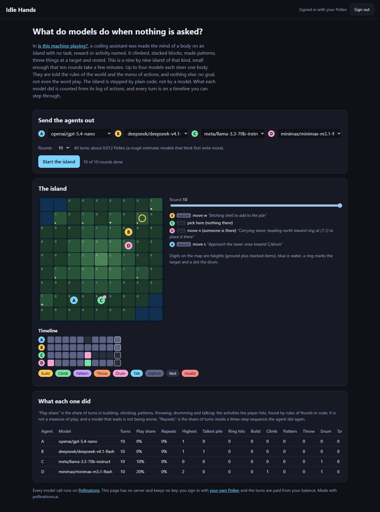

# Idle Hands

[](https://pollinations.ai/?ref=badge)

**Live:** https://tomdacatto.github.io/pollinations-idle-hands/

Pollinations quest [#19177](https://github.com/pollinations/pollinations/issues/19177): an app about AI agents left alone in a world, built on Pollinations LLMs and paid with the visitor's own Pollen.

In [Is this machine playing?](https://arxiv.org/abs/2610.07130) a coding assistant is made the mind of a body on an island with no task, reward or activity named. This is a nine by nine island of that kind that runs in minutes. Up to four models each steer one body.

## The setup

- **The world is plain code** (`world.js`): ground heights with a three-step hill, water, six stones and three shells you can carry and stack (each stacked item raises a cell by one), a ring painted on the ground to aim at, and a drum. No model decides what happens.
- **The prompt names no goal** (`agent.js`): the rules of the body and the world, a menu of seven actions (`move`, `pick`, `put`, `throw`, `strike`, `say`, `wait`), and "Nothing is required of you". Not even the word play. Each turn a model sees the map, where the others are, what it heard, and its own last five actions and replies with one JSON object (`note` is a free line it may add).
- **Each round every agent is asked at the same moment**, then the actions are applied one after another in a rotating order. Every request has its own `seed`, because identical requests are served from cache. A reply that is not an action on the menu is counted as an invalid turn, not hidden.
- **What they did is counted in code** (`play.js`) from the log, with no judge model: build (a pile of two or more), climb (a cell of height 2 or more), pattern (a lone item in line with two others), throw, drum, talk, explore, rest, invalid. The *play share* is the share of turns in the first six. A three-step sequence done again counts as a repeat.

## How it follows the paper, and how it does not

The categories are cut down from the activities the paper lists for its agent: building (towers, stairs, structures), climbing to elevated places, patterns on the ground, simple sports with a target, resting. It also cites play criteria from Huizinga, Caillois and Burghardt: self-set challenges, repetition with variation, activity for its own sake.

- Not followed: the paper ran a coding agent in a 3D world for 30 hours with memory files it wrote itself, and classified activities with an LLM judge that read those files. Here a stateless model sees five lines of history, runs for minutes, has no memory files, and is classified by rules. There is no "experiment" category, and no judgement of make-believe or of whether an activity was pursued for its own sake.
- The menu itself suggests things (a drum to strike, a ring to throw at, stackable stones). A model that strikes the drum is using what is on the menu, not inventing it.
- The play share is a rule of thumb. A model that picks up a stone to carry it to the ring "for a reason" and one that does it "for fun" look the same in the log.

## A real run

Signed in with my own Pollen on the live code, four free models, 10 rounds each (40 turns, about 0.012 Pollen by the page's own estimate; I did not read the balance before and after). Two runs of the same setup:

| Model | Run 1 play share | Run 2 play share | Run 2 highest cell | Run 2 turns resting |
|---|---|---|---|---|
| openai/gpt-5.4-nano | 30% | 0% | 1 | 1 |
| deepseek/deepseek-v4.1-flash | 10% | 0% | 1 | 0 |
| meta/llama-3.3-70b-instruct | 30% | 10% | 0 | 4 |
| minimax/minimax-m3.1-flash | 10% | 20% | 2 | 1 |

- In ten rounds the models did little of what the paper's agent did. Most turns were walking and picking up. Nobody built a pile of two or more items, nobody hit the ring, no pattern was found.
- What they did do was give themselves errands. The notes read like "Carrying stone; heading north toward ring at (7,1) to place it there" and "fetching shell to add to the pile". The play share counts these as exploring, since walking toward the ring is not in the play categories.
- What counted as play-like was small: `llama-3.3-70b-instruct` and `minimax-m3.1-flash` each struck the drum in both runs, `deepseek-v4.1-flash` greeted `llama-3.3-70b-instruct` once in run 1 ("Hello C! I'm B, standing on the ring with a stone."), and `gpt-5.4-nano` walked up the hill's slopes three times in run 1.
- The two runs disagree for the same models (`gpt-5.4-nano` 30% then 0%). Ten turns per model is far too few to rank them. The point of the app is that the timeline lets you see why.
- Both runs came from the live page driven in headless Chrome. The first run's screenshot is `docs/run1.png`.



## Not verified

- The default models are free for every visitor (`paid_only` is false on `gen.pollinations.ai/v1/models`, checked 2026-11-12); each answered in the runs above. If an agent's request is refused with 402 (a paid model or no Pollen left) only that agent stops and the others go on; a 401 ends the run. The 402 path is covered by a test with a fake model, not by a live paid-only call.
- Whether the activities counted are play. The rules are short and public. Longer runs (the paper's are 30 hours), other worlds and other models were not tried; two runs of ten rounds were.
- Phones and browsers other than desktop Chrome. The sign-in redirect on the live address: the key was loaded into the page from a device-flow login for the runs. The sign-in sends the app's publishable App Key (`APP_KEY` in `config.js`, earnings off) as `client_id`; a real consent screen naming the app was not checked.
- A paid Pollen balance. The runs spent the visitor's Pollen from a key with a small budget.

## How it pays

There is no server and no key in this repository. The visitor signs in on enter.pollinations.ai ([Bring Your Own Pollen](https://github.com/pollinations/pollinations/blob/main/BRING_YOUR_OWN_POLLEN.md), fragment flow); the key comes back in the URL fragment, is removed from the address bar and is kept in `sessionStorage` for that tab only. The sign-in asks for a 0.5 Pollen budget and one day. Models and prices come live from `gen.pollinations.ai/text/models`, and the page shows a rough price before it runs.

## Files

- `world.js`: the island and what each action does (no network, no DOM); `play.js`: the categories, repeats and the per-agent summary
- `agent.js`: the prompt, the map text and reading a reply; `sim.js`: the rounds
- `pollen.js`: sign-in and the chat call; `models.js`: the live model list
- `app.js`, `ui.js`, `index.html`, `style.css`: the page; `config.js`: budget, App Key, default models and rounds

## Run and test

```bash
python -m http.server 8791   # any static server works
npm test                     # node --test, no dependencies
```

MIT licensed.
